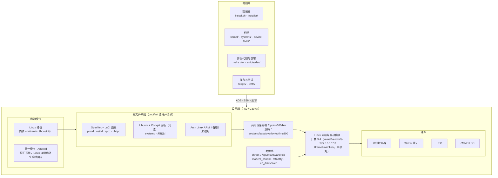
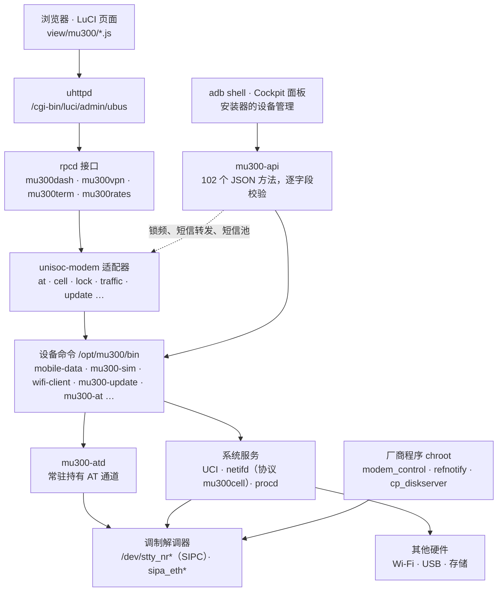

# 架构图

本文给出两张图：总体架构，以及设备端一次操作从界面到硬件的控制链路。目录级说明见 [项目目录说明](PROJECT-STRUCTURE.zh-CN.md)。

图依据仓库源码绘制，并于 2026-11-12 在一台运行中的 F50 上通过 adb 做了只读核对（见 [第 3 节](#3-设备核对记录2026-11-12)）。核对只覆盖这台设备当时运行的组合：OpenWrt 面板版 + 厂商 5.4 内核。图中标为“未核对”的部分只有源码依据。

## 1. 总体架构

要点：

- 电脑端的四类工具都不在设备上运行，它们通过 ADB、SSH 和刷写作用于设备。
- 设备有 A、B 两个启动槽位。Android 留在一个槽位不动，Linux 内核和 `boot/init` 装进另一个槽位。`boot/init` 加载驱动、找到根文件系统并切换到所选系统；Linux 连续启动失败会回退 Android。
- 各发行版共用同一套内核和 `/opt/mu300/bin` 设备命令，所以查设备功能不能只看 `systems/openwrt/`。
- 调制解调器依赖三个 Android 厂商程序，它们在 Linux 里以 chroot 方式运行（隔离程度见核对记录）。

## 2. 设备端控制链路（OpenWrt 面板版）

要点：

- 有两个入口。浏览器走 uhttpd、rpcd，再经 `unisoc-modem` 适配器；adb 和 Cockpit 走 `mu300-api`。两条路都落到 `/opt/mu300/bin`，所以改设备行为通常改这里，而不是改页面。
- `mu300-api` 在锁频、短信转发和短信池上会反过来调用面板的适配器和 `mu300dash`（图中虚线）。
- 所有 AT 命令经 `mu300-at` 交给常驻的 `mu300-atd`。SIPC 串口关闭后会卡死，所以通道只由守护进程持有。
- 数据面不经过上述链路：蜂窝数据是 `sipa_eth0`，由 netifd 的 `mu300cell` 协议作为 `wan` 管理；`br-lan` 桥接 Wi-Fi 热点（`wlan0`）和 USB 网卡（`usb0`）。

## 3. 设备核对记录（2026-11-12）

通过 adb 以 root 进入设备，只执行了读取命令（`ps`、`ls`、读 `/proc` 与 `/sys`、`ubus list`、`ubus call network.interface.wan status`、`mu300-api --methods`）。没有重启设备或任何服务，没有发送 AT 命令，没有修改文件或配置。

| 图中的说法 | 设备上看到的 | 结论 |
|---|---|---|
| Linux 在独立的启动槽位 | 内核命令行 `androidboot.slot_suffix=_b` | 相符 |
| 根文件系统在 eMMC 空闲区域或 SD 卡 | `/` 是 ext4，位于 `/dev/loop0`，其后端为 `/dev/mmcblk0`；本机没有 SD 卡设备 | 相符（本机走 eMMC） |
| 厂商 5.4 内核 | `5.4.254`，已加载 105 个模块，含 `sipc_core`、`sipa_*`、`wcn_bsp`、`sprd_wlan_combo`、`mali_kbase` | 相符 |
| OpenWrt 面板版 | OpenWrt 25.12.6，镜像 `v2026.11.02.1`，PID 1 是 `procd`；`rpcd`、`uhttpd`、`netifd`、`ttyd`、`mu300-smsd` 在运行 | 相符 |
| rpcd 接口 | ubus 上有 `mu300dash`、`mu300vpn`、`mu300term`、`mu300rates` | 相符；初稿漏了 `mu300rates`，已补 |
| 适配器与页面 | `/usr/libexec/unisoc-modem/` 的 19 个适配器、`view/mu300/` 的 27 个页面与仓库文件名一致 | 相符（只比对了文件名，未比对内容） |
| 共用设备命令 | `/opt/mu300/bin` 有 77 个文件；`mu300-api --methods` 列出 102 个方法，与 [API 文档](../api/README.md) 一致 | 相符 |
| `mu300-atd` 常驻持有 AT 通道 | 守护进程在运行，持有 `/dev/stty_nr0`、`stty_nr1`、`stty_nr6` | 相符 |
| 厂商程序在沙箱中运行 | 三个进程的根目录是 `/opt/mu300/android`。`modem_control`、`refnotify` 以 uid 1000 运行，只保留少量 capability；`cp_diskserver` 以 root 运行并保留全部 capability。三者与主系统共用挂载和 PID 命名空间，未启用 seccomp | 部分相符：隔离手段是 chroot、专用账号和削减 capability，不是命名空间沙箱；图中已改称“chroot” |
| 调制解调器设备节点归专用账号 | `/dev/stty_nr*` 属主 uid 1000，权限 `crw-rw----` | 相符 |
| 数据面 | `wan` 的协议是 `mu300cell`，三层设备 `sipa_eth0`；`br-lan` 成员为 `usb0`、`wlan0` | 初稿未画，已在第 2 节补充说明 |
| adb 入口 | `/opt/mu300/bin/adbd` 在运行，本次核对即经由它 | 相符 |

未能核对的部分：

- Ubuntu、Cockpit 面板和 Arch：这台设备只装了 OpenWrt 面板版。
- 主线 6.18 / 7.3 内核：设备运行的是厂商 5.4。
- 启动失败回退 Android：验证它需要重启，本次明确不重启。
- SSH 入口：设备的 22 端口可达，但需要密码登录，本次没有使用。
- 设备上的文件内容是否与当前仓库源码完全一致：接口层的 7 个文件（`mu300dash`、`mu300vpn`、`mu300term`、`mu300rates.uc`、`mu300-api`、`mu300-device`、`luci-app-mu300.json`）的 SHA-256 与仓库相同；其余文件只比对了文件名和数量。
